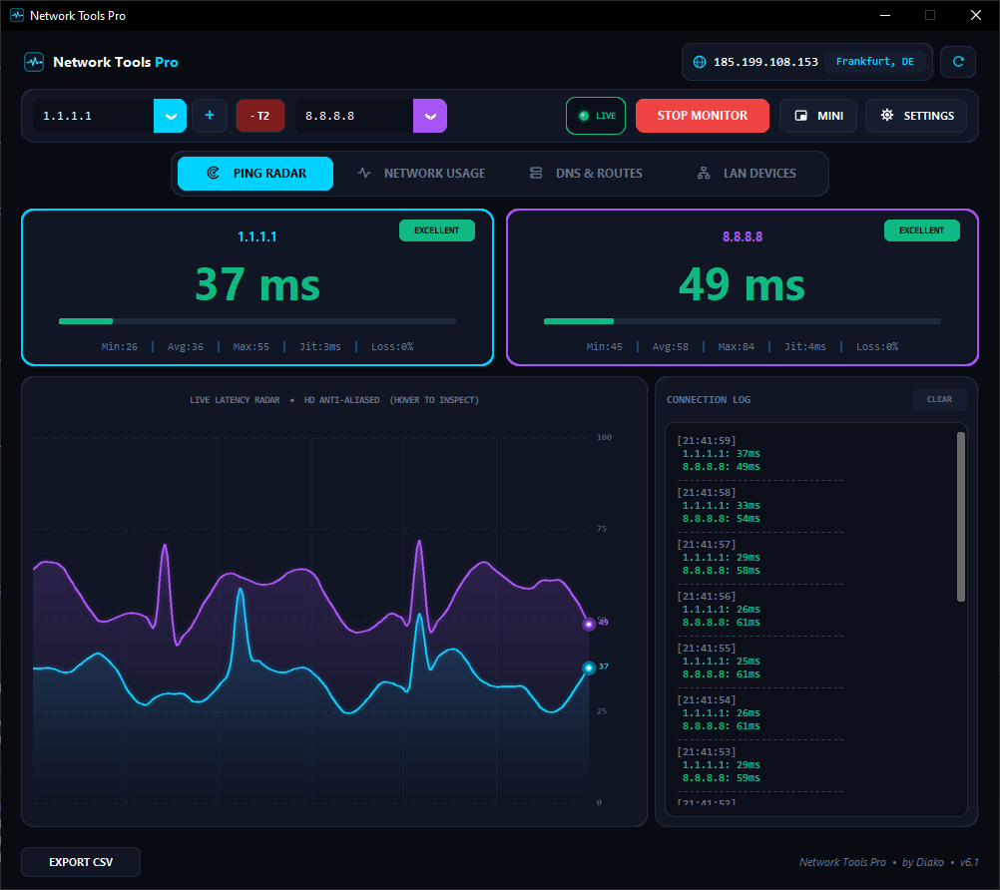
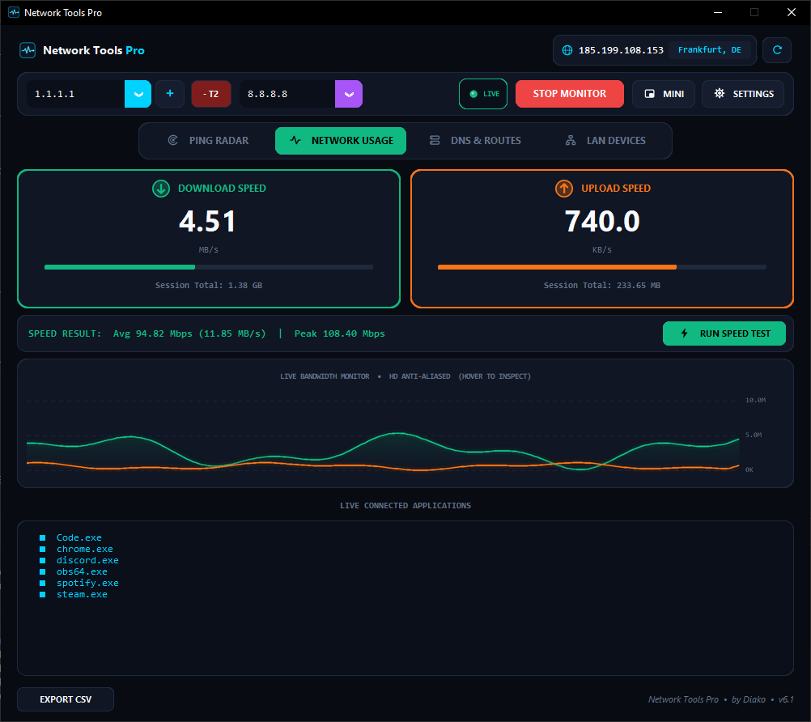
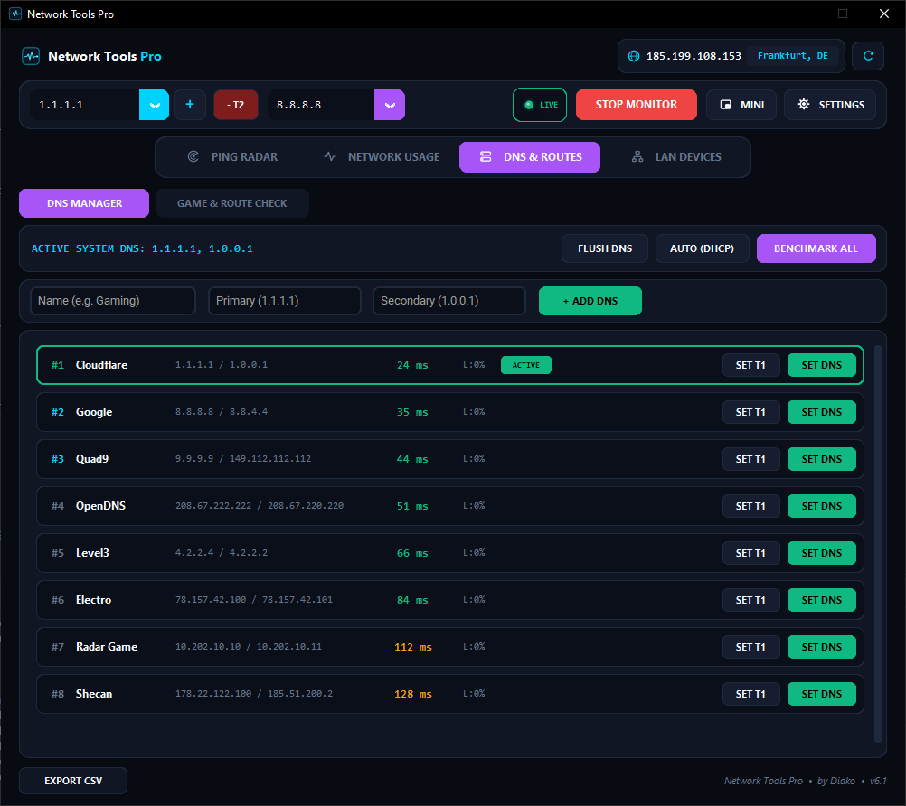
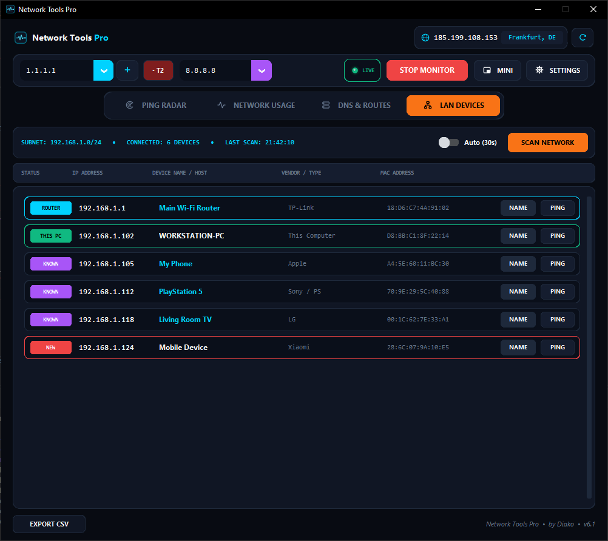
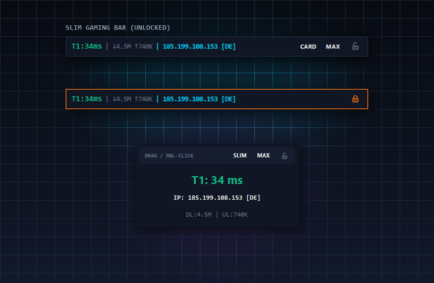

<div align="center">
  
  <h1>Network Tools Pro</h1>
  <p><strong>جعبه ابزار مدرن، سبک و رایگان ویندوز برای مانیتورینگ زنده پینگ، تحلیل پهنای باند، بنچمارک DNS و شناسایی دستگاه‌های شبکه محلی</strong></p>

<p>
    🌐 <a href="README.md"><strong>English</strong></a> &nbsp;|&nbsp; <strong>راهنمای فارسی</strong>
  </p>

  <p>
    <a href="https://github.com/DIAKODE/network-tools-pro/releases">
      
    </a>
    
    
    <a href="LICENSE">
      
    </a>
  </p>

  <p>
    <a href="#-امکانات-برنامه">امکانات</a> •
    <a href="#-تصاویر-محیط-برنامه">تصاویر</a> •
    <a href="#-دانلود-و-نصب">دانلود و اجرا</a> •
    <a href="#-اجرا-و-بیلد-از-سورس">سورس و بیلد</a> •
    <a href="#-میانبرها-و-نکات-کاربردی">میانبرها</a>
  </p>
</div>

---

<div align="center">
  
</div>

---

<div dir="rtl">

## ✨ امکانات برنامه

### 📡 رادار زنده پینگ (Live Ping Radar)
- **مانیتورینگ هم‌زمان دو سرور (T1 و T2):** رصد لحظه‌ای یک یا دو آدرس با نمایش `Min`، `Avg`، `Max`، `Jitter`، درصد `Packet Loss` و نشانگر کیفیت اتصال (`EXCELLENT` تا `POOR`).
- **نمودارهای گرافیکی نرم و تعاملی:** رندر اختصاصی `2× SSAA` با منحنی‌های نرم و نمایش جزئیات دقیق هر ثانیه با حرکت موس روی نمودار.
- **افزودن سریع تارگت دلخواه:** نوار کشویی `+` برای وارد کردن آی‌پی یا دامنه موقت یا دائمی (با استخراج خودکار دامنه از لینک‌های کپی‌شده).
- **تاریخچه طولانی و خروجی CSV:** ثبت رنگی تا ۱۲۰۰ خط از گزارش اتصال و امکان ذخیره فایل `CSV` در مسیر دلخواه با پنجره استاندارد ویندوز.

### 📊 مصرف شبکه و تست سرعت (Network Usage)
- **نمایش زنده سرعت دانلود و آپلود:** همراه با حجم کل مصرفی در نشست فعلی و نمودار زنده پهنای باند.
- **تست سرعت داخلی (Speed Test):** اندازه‌گیری سرعت واقعی خط (میانگین و حداکثر به `Mbps` و `MB/s`) مستقیماً داخل خود برنامه.
- **لیست برنامه‌های متصل به اینترنت:** مشاهده لحظه‌ای نرم‌افزارهایی که در حال حاضر اتصال فعال روی شبکه دارند.

### 🌐 مدیریت DNS و تست مسیر سرورهای گیم (DNS & Routes)
- **بنچمارک موازی DNSها:** تست هم‌زمان تمام سرورهای DNS و رتبه‌بندی آن‌ها بر اساس کمترین پینگ و کمترین Packet Loss.
- **تغییر DNS ویندوز با یک کلیک:** اعمال هم‌زمان DNS اصلی و فرعی روی کارت شبکه فعال، بازگشت به حالت خودکار (`AUTO / DHCP`) و پاک‌سازی کش (`FLUSH DNS`).
- **تست مسیر گیم و کلود (Game & Route Check):** بررسی پینگ، جیتر و پایداری اتصال به سرورهای محبوب بازی، ویس و سرویس‌های ابری.

### 🖥️ اسکنر دستگاه‌های شبکه محلی (LAN Devices)
- **شناسایی سریع دستگاه‌های متصل به مودم/وای‌فای:** کشف گوشی‌ها، سیستم‌ها، تلویزیون و کنسول‌ها حتی زمانی که VPN روی سیستم روشن است.
- **تشخیص برند و نام‌گذاری دائمی:** شناسایی سازنده دستگاه از روی مک‌آدرس و امکان ذخیره نام دلخواه برای هر دستگاه.
- **اسکن خودکار پس‌زمینه و هشدار دستگاه جدید:** قابلیت اسکن هر ۳۰ ثانیه یک‌بار و ارسال نوتیفیکیشن هنگام اتصال دستگاه ناشناس به وای‌فای.

### 🎮 مینی‌مود گیمینگ و آیکون هوشمند کنار ساعت (Mini Overlay & Tray)
- **دو حالت نمایش شناور:** انتخاب بین **کارت جمع‌وجور (`CARD`)** و **نوار افقی باریک (`SLIM`)** با نمایش زنده پینگ، سرعت، آی‌پی و کشور.
- **قفل هوشمند روی بازی (Click-Through):** با قفل کردن نوار، کلیک‌های موس مستقیماً از روی آن رد شده و وارد بازی می‌شوند؛ برای باز کردن قفل کافی است روی آیکون قفل انتهای نوار کلیک کنید یا از هرجای ویندوز کلیدهای `Ctrl + Shift + L` را بزنید.
- **آیکون هوشمند System Tray:** نمایش خلاصه پینگ، سرعت و کشور هنگام بردن موس روی آیکون کنار ساعت، همراه با منوی دسترسی سریع و جلوگیری از اجرای تکراری برنامه.

### 🎨 شخصی‌سازی و هشدارهای هوشمند
- **۵ تم آماده تیره و روشن:** شامل `Cyberpunk Dark`، `Light Pro`، `Emerald Matrix`، `Crimson Neon` و `Oceanic Blue`.
- **سیستم صوتی داخلی بدون نیاز به فایل خارجی:** ۳ پروفایل صدای متفاوت، کنترل زنده ولوم و امکان انتخاب فایل `.wav` دلخواه.
- **اعلان‌های هوشمند ویندوز:** هشدار هنگام قطع یا وصل شدن اینترنت، بالا رفتن پینگ از حد مجاز و تغییر آی‌پی یا قطع شدن VPN (همراه با نمایش شهر و کشور آی‌پی فعلی).

---

## 📸 تصاویر محیط برنامه

</div>

| مصرف شبکه و تست سرعت | مدیریت و بنچمارک DNS |
| :---: | :---: |
|  |  |

| اسکنر دستگاه‌های شبکه محلی (LAN) | نوار شناور گیمینگ (قابل قفل روی بازی) |
| :---: | :---: |
|  |  |

---

<div dir="rtl">

## 🚀 دانلود و نصب

### روش اول: نسخه پرتابل و آماده (پیشنهادی)
1. وارد صفحه [**Releases (انتشارها)**](https://github.com/DIAKODE/network-tools-pro/releases) شوید.
2. فایل **`Network Tools Pro.exe`** را دانلود کنید (تک‌فایل، بدون نیاز به نصب و بدون نیاز به پایتون).
3. فایل را مستقیماً روی ویندوز ۱۰ یا ۱۱ اجرا کنید.

> **نکته درباره هشدار Windows SmartScreen:** از آنجایی که فایل اجرایی بدون گواهی دیجیتال پولی و با PyInstaller بسته‌بندی شده، ممکن است ویندوز در اولین اجرا پیام هشدار نمایش دهد. در این صورت روی **More info** و سپس **Run anyway** کلیک کنید، یا برای اطمینان کامل کد `SHA256` درج‌شده در صفحه Release را بررسی کرده و یا خودتان مستقیم از سورس‌کد زیر بیلد بگیرید.

### روش دوم: اجرا مستقیم از سورس‌کد (پایتون)

</div>

```bash
git clone [https://github.com/DIAKODE/network-tools-pro.git](https://github.com/DIAKODE/network-tools-pro.git)
cd network-tools-pro
pip install -r requirements.txt
python main.py
```

<div dir="rtl">

---

## 🛠️ سورس و بیلد گرفتن (تولید فایل exe)

برای ساخت فایل اجرایی تک‌فایل از سورس، ابتدا `PyInstaller` را نصب کنید و اسکریپت `build.bat` را اجرا کنید:

</div>

```bash
pip install pyinstaller
build.bat
```

<div dir="rtl">

یا به صورت دستی دستور زیر را اجرا کنید تا خروجی داخل پوشه `dist` ساخته شود:

</div>

```bash
python -m PyInstaller --noconsole --onefile --icon=app_icon.ico --name "Network Tools Pro" main.py
```

<div dir="rtl">

---

## ⌨️ میانبرها و نکات کاربردی

| عملکرد | کلید میانبر / روش اجرا |
| :--- | :--- |
| قفل و باز کردن مینی‌مود روی بازی | کلیدهای `Ctrl + Shift + L` یا کلیک روی آیکون قفل انتهای نوار / منوی Tray |
| خروج از مینی‌مود و بازگشت به پنجره اصلی | دابل‌کلیک روی مینی‌مود یا کلیک روی دکمه `MAX` |
| کپی سریع آی‌پی عمومی | کلیک روی کادر آی‌پی در گوشه بالا سمت راست برنامه |
| تایید یا بستن نوار تارگت دلخواه | دکمه `Enter` برای اعمال • دکمه `Esc` برای بستن |

---

## 📄 لایسنس

این پروژه به صورت متن‌باز و تحت لایسنس **MIT** منتشر شده است. برای جزئیات بیشتر فایل [`LICENSE`](LICENSE) را مشاهده کنید.

</div>

<div align="center">
  <sub>توسعه‌داده‌شده توسط <strong>DIAKO</strong></sub>
</div>
