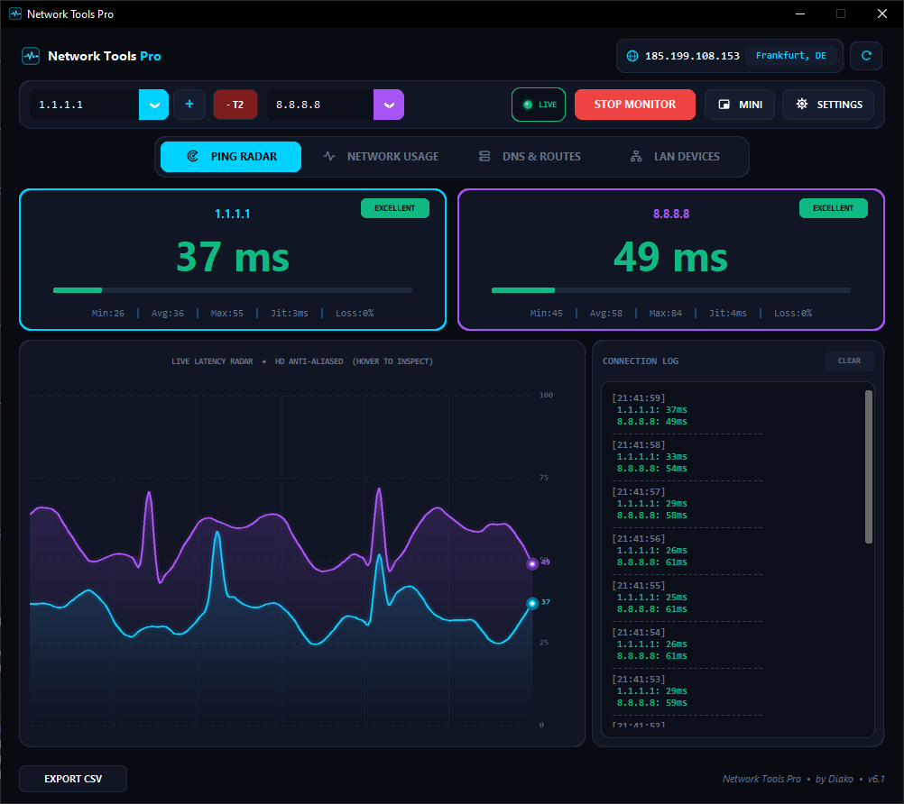
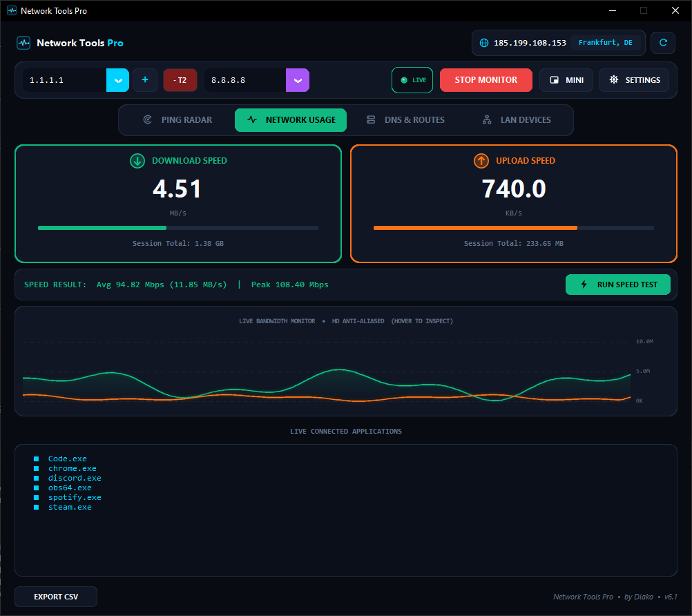
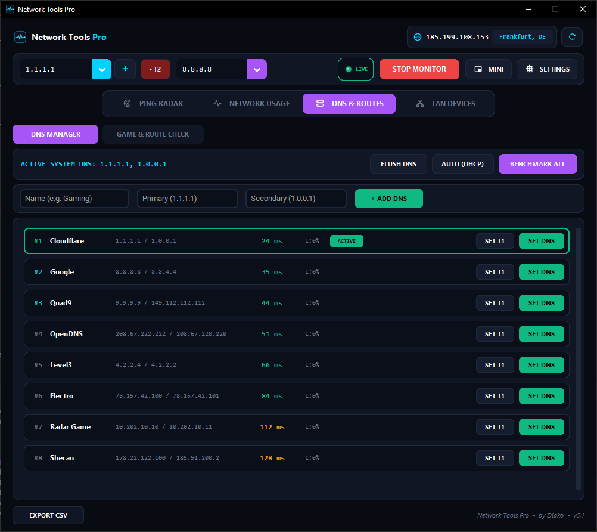
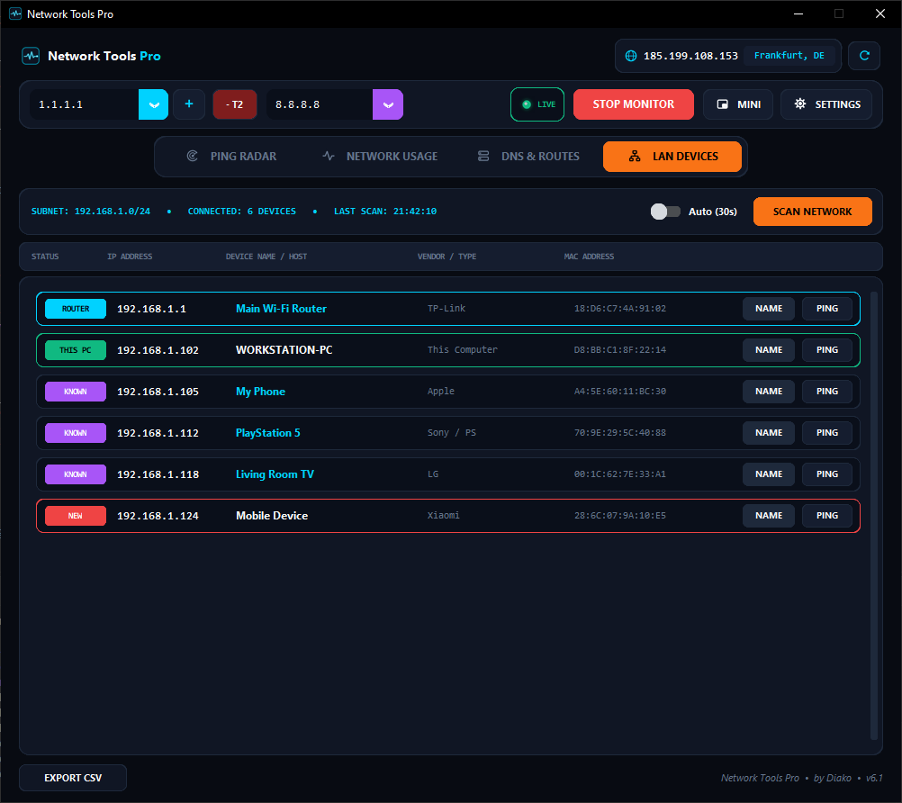
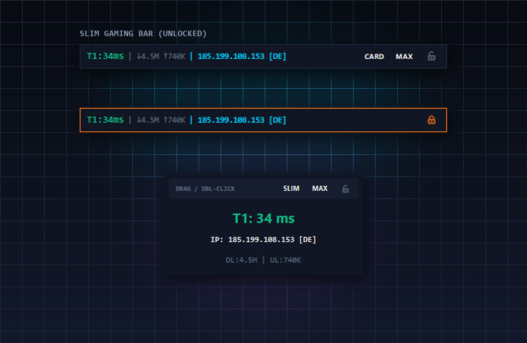

<div align="center">
  
  <h1>Network Tools Pro</h1>
  <p><strong>A modern, lightweight Windows desktop suite for real-time latency monitoring, bandwidth analytics, DNS benchmarking, and LAN device discovery.</strong></p>

<p>
    <a href="README.md">
      
    </a>
    <a href="README.fa.md">
      
    </a>
  </p>
  <p>
    <a href="https://github.com/DIAKODE/network-tools-pro/releases">
      
    </a>
    
    
    <a href="LICENSE">
      
    </a>
  </p>

  <p>
    <a href="#-features">Features</a> •
    <a href="#-screenshots">Screenshots</a> •
    <a href="#-download--installation">Download</a> •
    <a href="#-building-from-source">Build</a> •
    <a href="#-architecture">Architecture</a>
  </p>
</div>

---

<div align="center">
  
</div>

---

## ✨ Features

### 📡 Live Ping Radar
- **Dual-Target Monitoring (T1 & T2):** Track one or two hosts simultaneously with real-time Min, Avg, Max, Jitter, Packet Loss, and connection quality badges (`EXCELLENT`, `GOOD`, `FAIR`, `UNSTABLE`, `POOR`).
- **HD Anti-Aliased Interactive Graphs:** Custom 2× SSAA Pillow rendering with smooth Catmull-Rom curves, gradient fills, and hover-to-inspect crosshair tooltips.
- **Quick Custom Target Bar:** Clean dropdown selection paired with a slide-down `+` bar to add temporary or saved IP/domain targets (automatically extracts hostnames from pasted URLs).
- **Extended Connection Log & CSV Export:** Color-coded history retaining up to 1,200 lines with one-click export via native Save As dialog.

### 📊 Network Usage & Speed Test
- **Live Throughput Dashboard:** Real-time Download/Upload speeds, session data totals, and a 2× SSAA bandwidth chart with hover inspection.
- **Built-in Speed Test:** Measure real line throughput (Average & Peak Mbps / MB/s) directly inside the app.
- **Active Connections Inspector:** Live list of processes currently holding established network connections.

### 🌐 DNS Manager & Game Route Check
- **Parallel DNS Benchmark:** Test all configured DNS servers simultaneously and rank them by packet loss and average latency.
- **One-Click System DNS Control:** Apply Primary + Secondary DNS to active Windows adapters, reset to DHCP, or flush Windows DNS cache.
- **Game & Cloud Route Check:** Measure latency, jitter, and packet loss to popular gaming, voice, and cloud endpoints (Steam EU, Riot EU, AWS Frankfurt, Discord, Cloudflare, etc.).

### 🖥️ Local Network (LAN) Devices
- **Fast Subnet Discovery:** Parallel ping sweep + Windows ARP table inspection to uncover phones, PCs, routers, TVs, and consoles—even while a VPN is active.
- **Vendor Identification & Persistent Labeling:** Identifies device manufacturers via MAC OUI (plus randomized mobile MAC detection) and lets you save permanent custom labels per MAC address.
- **Background Auto-Scan & Alerts:** Optional 30-second background scan that alerts you when an unknown device joins your Wi-Fi/LAN.

### 🎮 Gaming Mini Overlay & Smart System Tray
- **Two Overlay Modes:** Switch between a **Compact Card** and a fixed-width **Slim Gaming Bar** displaying live ping, speeds, public IP, and country code.
- **Click-Through Game Lock:** Lock the overlay so mouse clicks pass straight through into games or apps—while hovering directly over the lock icon lets you click to unlock instantly (or press `Ctrl + Shift + L` anywhere).
- **Smart System Tray:** Live tooltip displaying ping, speeds, and region on hover, plus quick right-click actions (`Start/Stop`, `Mini Mode`, `Unlock Overlay`) and Win32 single-instance protection.

### 🎨 Customization & Smart Alerts
- **5 Built-in Themes:** `Cyberpunk Dark`, `Light Pro`, `Emerald Matrix`, `Crimson Neon`, and `Oceanic Blue`.
- **Procedural Audio Engine:** 3 synthesized alert profiles (`Soft Glass`, `Cyber Radar`, `Minimal Pop`), live volume control, and custom `.wav` file support.
- **Proactive Notifications:** Instant alerts for connection drops/restores, high-ping spikes, and VPN / public IP changes (with live city & country detection).

---

## 📸 Screenshots

| Network Usage & Speed Test | DNS Manager & Route Check |
| :---: | :---: |
|  |  |

| Local Network (LAN) Scanner | Slim Gaming Overlay (Click-Through) |
| :---: | :---: |
|  |  |

---

## 🚀 Download & Installation

### Option 1: Portable Executable (Recommended)
1. Go to the [**Releases**](https://github.com/DIAKODE/network-tools-pro/releases) page.
2. Download **`Network Tools Pro.exe`** (standalone, no Python required).
3. Run it directly on Windows 10 or Windows 11.

> **Note on Windows SmartScreen:** Because this executable is unsigned and packaged with PyInstaller, Windows Defender SmartScreen may display a warning on first launch. Click **More info → Run anyway**, verify the SHA256 checksum listed in the release notes, or build it yourself from source below.

### Option 2: Run from Source
```bash
git clone [https://github.com/DIAKODE/network-tools-pro.git](https://github.com/DIAKODE/network-tools-pro.git)
cd network-tools-pro
pip install -r requirements.txt
python main.py
```

---

## 🛠️ Building from Source

Install PyInstaller and run the included build script:

```bash
pip install pyinstaller
build.bat
```

Or compile manually:

```bash
python -m PyInstaller --noconsole --onefile --icon=app_icon.ico --name "Network Tools Pro" main.py
```

The standalone executable will be generated inside `dist/Network Tools Pro.exe`.

---

## 🗂️ Architecture

```text
NetworkToolsPro/
├── main.py                 # Entry point & single-instance bootstrap
├── core/
│   ├── config.py           # Themes, constants, MAC vendors & JSON persistence
│   ├── net_engine.py       # Ping, GeoIP, speed test, DNS/route benchmarks & LAN scanner
│   └── win_audio.py        # Win32 mutex, Click-Through API, Windows DNS, autostart & WAV synth
└── ui/
    ├── graphics.py         # 2x/4x SSAA Pillow renderer for graphs, icons & status LEDs
    ├── main_window.py      # Main window shell, header, target bar & tab orchestration
    ├── tray_mini.py        # Smart system tray & lockable Mini/Slim gaming overlay
    ├── settings_win.py     # Preferences modal & LAN device labeling dialog
    ├── tab_ping.py         # Ping Radar tab
    ├── tab_network.py      # Network Usage & Speed Test tab
    ├── tab_dns.py          # DNS Manager & Game Route Check tab
    └── tab_lan.py          # LAN Devices Scanner tab
```

---

## ⌨️ Shortcuts & Quick Tips

| Action | Shortcut / Gesture |
| :--- | :--- |
| Unlock Click-Through Gaming Overlay | `Ctrl + Shift + L` (or click the lock icon / Tray menu) |
| Exit Mini Mode to Centered Window | Double-click overlay or click `MAX` |
| Copy Public IP to Clipboard | Click the IP badge in the top-right header |
| Apply / Close Custom Target Bar | `Enter` to apply • `Esc` to close |

---

## 📄 License

Distributed under the **MIT License**. See [`LICENSE`](LICENSE) for details.

<div align="center">
  <sub>Built with precision by <strong>DIAKO</strong></sub>
</div>
